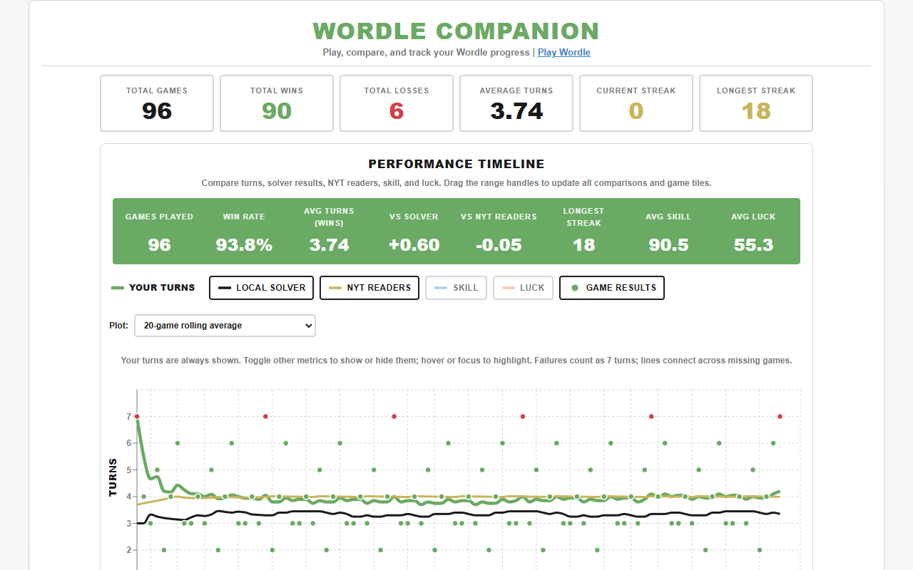
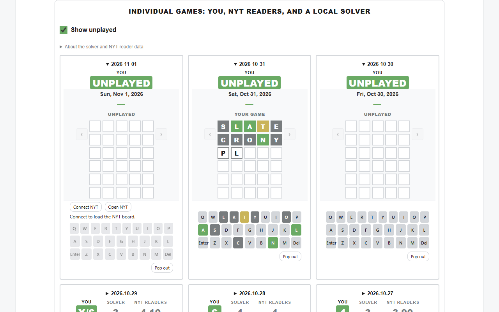
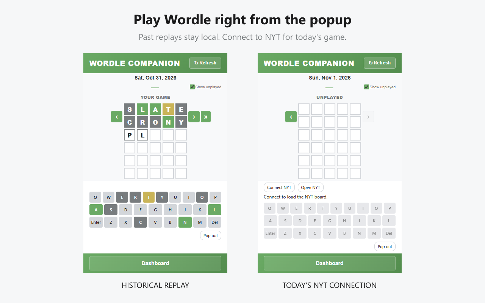
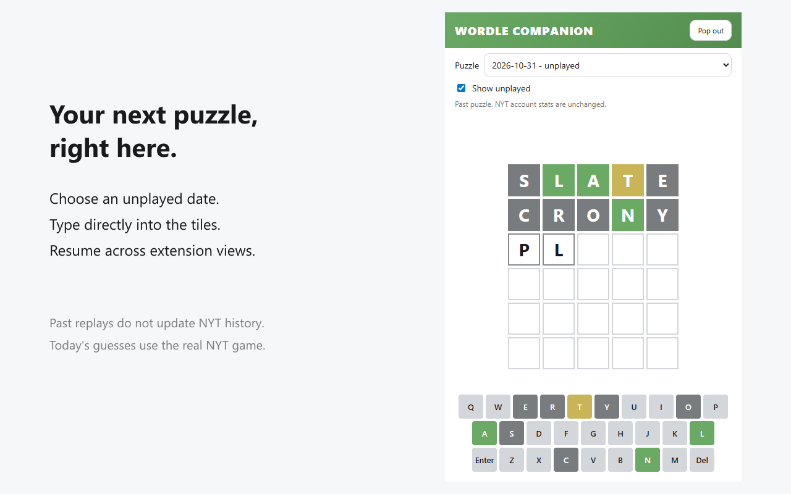

# Wordle Companion — Play & Stats

Play Wordle and explore your WordleBot history in one Chrome/Edge extension. Resume puzzles in the toolbar popup, persistent pop-out, or dashboard; track your progress and compare results with NYT readers and a local solver.

## ✨ Capabilities

- **Play in place:** Unplayed boards automatically become playable. Use your physical keyboard or the on-screen keys, with letter pops, feedback flips, invalid-word shakes, and reduced-motion support.
- **Browse and resume:** **Show unplayed** includes blank records and missing dates. Browse with popup arrows or Left/Right keys, open dashboard tiles, or use the puzzle picker. Drafts and guesses synchronize across views; **Pop out** stays open after the toolbar popup closes.
- **Track performance:** Quick stats and dashboard charts cover game counts, wins, average turns, distributions, streaks, and available WordleBot skill/luck scores. Completed extension games update dashboard timelines and statistics.
- **Compare results:** Plot your turns, local solver turns, NYT reader averages, skill, and luck as individual games, rolling averages, or cumulative averages. Toggle metrics and drag the date range to update head-to-head stats and game tiles.
- **Review boards:** Compare feedback-colored user and solver guess paths. Finished games switch from the keyboard to completed-game comparisons; imported played games remain read-only.
- **Import reliably:** Automatic, incremental, and full refresh reconcile available WordleBot history, including gaps and partial records. Interrupted imports preserve results already read and can be retried without duplication. NYT access and history availability limits apply.
- **Keep control:** Local storage, light/dark/system themes, and dashboard import/export and deletion controls. No telemetry, extension-operated cloud service, or separate extension account.

### Playing inside the extension

Turn on **Show unplayed** in the popup or Individual Games section, then open a blank date. There is no separate Play button or text editor: type into the board or click the keyboard. The dashboard's **Play Wordle** link also opens a dedicated view with a puzzle dropdown. **Pop out** opens a persistent Wordle-themed window that stays open when the toolbar popup closes.

| Puzzle                          | Feedback and persistence                                                                                                                                                                                                                              |
| ------------------------------- | ----------------------------------------------------------------------------------------------------------------------------------------------------------------------------------------------------------------------------------------------------- |
| Past, unplayed date             | The extension uses an available imported answer or retrieves that date's puzzle from NYT, then scores guesses locally with duplicate-letter handling. Replays do **not** update your NYT account or official history.                                 |
| Today's unplayed date           | Choose **Connect NYT**. Guesses are sent to the actual NYT game tab, and the extension displays the site's real feedback. Today's answer is not fetched or scored locally. Keep that tab available; NYT login or site dialogs may require opening it. |
| Date with an existing user game | Read-only review and comparisons; the extension does not replace your imported result.                                                                                                                                                                |

Incomplete extension sessions remain playable and can be resumed. Completed sessions appear in game browsing, dashboard timelines, and statistics, but extension progress stays separate from imported game records. The replay dictionary is not NYT's official guess list, so historical replays can accept words that the live NYT game rejects. Connecting to today's board is not a guarantee of signed-in account synchronization; NYT controls its own persistence.

### Understanding comparisons

The **local solver** is a normal-mode, WordleBot-style heuristic, not NYT WordleBot or a globally optimal solver. It starts with **RAISE**, handles duplicate letters, and chooses guesses using common-answer probabilities and information gain. Calculations run off the UI thread and are cached; unsupported answers show N/A. No proprietary NYT word list or solution sequence is bundled or fetched by the solver.

**NYT reader averages** come from WordleBot's per-puzzle summaries, with normal/hard mode identified when available; otherwise normal mode is used. Missing summaries show N/A, and manually entered figures are preserved. Head-to-head stats use matching played games within the selected range and expose comparison coverage. Your and the solver's failures count as seven turns. Green means you beat the benchmark, yellow a tie, and gray that it beat you.

The solver uses public-domain [dwyl/english-words](https://github.com/dwyl/english-words) and [Alternate 12Dicts](https://github.com/en-wl/wordlist), plus adapted [wordfreq](https://github.com/rspeer/wordfreq) frequency data under CC BY-SA 4.0. Pinned sources, credits, and licenses are in [the dictionary notice](src/solver/data/LICENSE.txt) and [packaged solver-data notice](public/solver-data-LICENSE.txt).

## 📸 Screenshots

Screenshots use synthetic demo history, not personal game records.









[Timeline comparisons](listing/assets/screenshot-02-comparisons.png) · [Dashboard and gameplay together](listing/assets/popupanddashboard.png)

## Install in Chrome/Edge

1. Run `npm install`, then `npm run build:extension` to produce a typechecked build in `dist/`.
2. Navigate to `chrome://extensions` (or `edge://extensions`).
3. Enable **Developer mode**.
4. Click **Load unpacked** and select the project’s `dist/` folder.
5. Click the extension toolbar icon to open the popup or visit the dashboard tab directly if already open.

## Development

Manifest V3 background/content/popup code lives in `src\extension`; the React/Vite dashboard is in `src\dashboard`, shared gameplay in `src\play`, and Zustand stores in `src\stores`. The worker manages imports, local storage, historical scoring, and today's NYT bridge.

```cmd
npm test
npm run lint
npm run build:extension
npm run test:e2e
```

Benchmark the solver with `npx tsx scripts\benchmark-solver.ts`. Regenerate its dictionaries with `node scripts\update-solver-dictionary.mjs` and `python scripts\update-solver-frequencies.py` (requires `msgpack==1.1.2`); dictionary or policy changes require a solver cache version bump.

## 🔒 Privacy

The extension stores your history and replay progress locally and has no telemetry or extension-operated cloud service. It requests NYT puzzle data and reader summaries, and today's gameplay sends guesses through the actual NYT site using your browser's NYT session. Historical replays do not upload results to NYT. See the [Privacy Policy](PRIVACY.md) for details.
